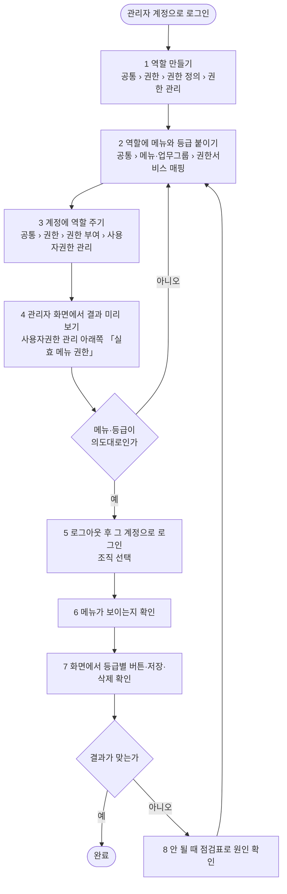
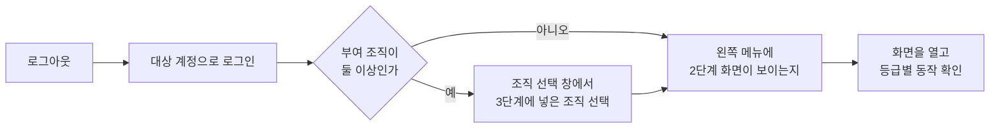

# 계정 권한 설정 순서 — 화면에서 따라 하기

## 개요
- 목적: 계정 하나에 권한을 만들어 주고, 그 계정으로 들어가 권한대로 동작하는지 화면에서 직접 확인하는 순서 정리
- 대상: 공통관리 화면을 검토하는 개발자·관리자
- 준비: 관리자 계정(erpadmin 등 SYS_ADMIN·BIZ_ADMIN 보유)으로 로그인 · 확인용 시험 계정은 `products-erp-h/docs/work/common-code-fn/시험계정-20261118.md` 참조
- 화면 구성·버튼 이름 근거: hmp `pages/role/role-service.js`, `pages/role/user-role.js` 와 라벨 데이터, 화면별 권한 정의표 `auth-def/<화면ID>.md`(2026-11-18 기준)

## 한눈에 보는 순서



- 1~3단계가 권한을 「정의하고 주는」 단계, 4~7단계가 「쓰면서 확인하는」 단계임
- 이미 있는 역할을 줄 때는 1·2단계를 건너뛰고 3단계부터 진행

## 1단계 — 역할 만들기

- 메뉴: 공통 › 권한 › 권한 정의 › 권한 관리 (ca-role)
- 역할 = 권한 묶음의 이름(예: 「협력업체 조회 담당」) · 이 단계에서는 이름만 만들고, 어떤 메뉴를 쓸지는 2단계에서 정함

| 순서 | 누르는 곳 | 하는 일 |
|---|---|---|
| 1 | 역할 목록 그리드 [추가] | 새 행 추가 |
| 2 | 행 입력 | 역할 ID, 역할 이름, 사용여부 Y 입력 |
| 3 | 위쪽 [저장] | 역할 저장 |

- 필요 등급: 이 화면 등급 2(추가·저장) · 삭제는 등급 3
- 안 쓰는 역할은 지우지 않고 사용여부 N 으로 끔 · 삭제는 잘못 만든 역할에만 사용
- 시스템관리자 역할은 시스템관리자만 만들고 고칠 수 있음

## 2단계 — 역할에 메뉴와 등급 붙이기

- 메뉴: 공통 › 메뉴·업무그룹 › 권한서비스 매핑 (ca-role-service)
- 이 단계에서 「이 역할은 어느 화면을, 어느 등급으로, 어디까지의 데이터를」 쓸지 정함

화면 배치:

```
┌──────────────┐   ┌───┐   ┌──────────────────────────────┐
│ 메뉴 목록     │   │ → │   │ 역할 목록                      │
│ (왼쪽)        │   │ ← │   │ (오른쪽 · 역할별 부여 화면)      │
│ 화면 체크     │   └───┘   │ 등급 · 데이터 범위 · 엑셀 허가   │
└──────────────┘           └──────────────────────────────┘
```

| 순서 | 누르는 곳 | 하는 일 |
|---|---|---|
| 1 | 오른쪽 「역할 목록」 | 1단계에서 만든 역할 선택 |
| 2 | 왼쪽 「메뉴 목록」 | 이 역할에 줄 화면 체크(여러 개 가능) |
| 3 | 가운데 [→] | 체크한 화면을 역할에 부여 · 회수는 오른쪽에서 고르고 [←] |
| 4 | 오른쪽 행의 칸 | 등급(1·2·3), 데이터 범위, 엑셀·파일·인쇄 허가 입력 |
| 5 | 위쪽 [저장] | 저장 |

- 등급의 뜻은 화면마다 다름 → 화면별 권한 정의표 `products-erp-h/docs/work/common-admin/dev-guide/auth-def/<화면ID>.md` 확인 · 일반적으로 1 조회, 2 입력·저장, 3 삭제·승인

| 데이터 범위 | 보이는 데이터 |
|---|---|
| 전체(ALL) | 모든 데이터 |
| 자기소속및하위(SELF_AND_BELOW) | 로그인 때 고른 조직과 그 하위 조직 |
| 자기소속(SELF) | 로그인 때 고른 조직 하나 |
| 본인(PERSONAL) | 본인이 입력한 데이터 |

- 왼쪽 메뉴 행을 더블클릭하면 그 화면을 이미 가진 역할 목록을 볼 수 있음(조회 전용)
- [기본 권한 생성] 버튼은 모듈 단위로 기본 부여를 한 번에 만드는 기능이며 등급 2 필요

## 3단계 — 계정에 역할 주기

- 메뉴: 공통 › 권한 › 권한 부여 › 사용자권한 관리 (ca-user-role)
- 같은 화면을 두 방향으로 씀: 권한 기준(역할을 먼저 고르고 사용자 추가) · 사용자 기준(사용자를 먼저 검색하고 역할 체크)

권한 기준으로 주는 순서:

| 순서 | 누르는 곳 | 하는 일 |
|---|---|---|
| 1 | 왼쪽 「역할 목록」 | 줄 역할 선택 |
| 2 | 오른쪽 사용자 목록 [사용자 추가] | 대상 사용자 검색·선택 |
| 3 | 추가된 행 | 조직(어느 부서·현장에서 쓰는 권한인지), 시작일, 종료일 확인 |
| 4 | 위쪽 [저장] | 부여 저장 |

사용자 기준으로 주는 순서:

| 순서 | 누르는 곳 | 하는 일 |
|---|---|---|
| 1 | 위쪽 검색 조건(사용자·부서·사용자 구분) → [조회] | 대상 사용자 찾기 |
| 2 | 왼쪽 「사용자 목록」 | 사용자 선택 |
| 3 | 오른쪽 권한 목록 | 줄 역할 체크(빼려면 체크 해제) |
| 4 | 위쪽 [저장] | 부여 저장 |

- 시작일 기본값은 오늘 · 협력업체는 종료일을 비우면 365일 뒤로 자동 설정
- 종료일이 지난 부여는 로그인에 쓰이지 않고, 매일 01:20 배치가 회수함
- 본인에게는 부여할 수 없음(시스템관리자 제외) · 시스템관리자 역할은 시스템관리자만 부여 가능
- 다른 길: 사용자가 개인 › 내 요청 › 권한·겸직 신청(ca-role-request)에서 신청 → 승인권자(등급 3)가 승인하면 같은 부여가 생김

## 4단계 — 관리자 화면에서 결과 미리 보기

- 메뉴: 사용자권한 관리 화면 아래쪽 「실효 메뉴 권한」 · 또는 공통 › 권한 › 권한 부여 › 사용자권한 조회 (ca-user-role-inquiry)
- 사용자를 고르면 그 사용자가 로그인했을 때 보일 메뉴·화면·등급·근거 역할이 표시됨
- 저장 직후 다시 조회되므로, 다른 계정으로 로그인하기 전에 여기서 먼저 확인
- 여기서 메뉴가 빠져 있으면 2단계(메뉴 연결) 또는 3단계(부여 기간·조직)를 다시 확인

## 5~7단계 — 그 계정으로 들어가서 확인



- 권한은 로그인할 때 정해지므로, 부여를 바꾼 뒤에는 반드시 다시 로그인
- 같은 계정이라도 로그인 때 고른 조직에 따라 메뉴와 보이는 데이터가 달라짐

화면에서 등급별로 확인할 것(일반적인 경우 · 정확한 기준은 화면별 권한 정의표):

| 부여 등급 | 화면에서 보여야 하는 것 | 해 볼 것 |
|---|---|---|
| 1 | 조회 버튼과 목록만 보임 · 저장·추가 버튼 없음 · 그리드 수정 불가 | 조회 결과가 데이터 범위대로 나오는지 |
| 2 | 저장·추가 버튼 보임 · 그리드 수정 가능 | 저장이 되는지 · 삭제 버튼이 등급 3 전용인 화면이면 삭제 버튼이 없는지 |
| 3 | 삭제·승인 등 상위 버튼까지 보임 | 삭제·승인이 되는지 |

- 버튼이 보이는데 눌렀을 때 「권한이 없습니다」(403) 또는 `AUTH_LEVEL_DENIED` 가 나면, 화면 버튼 조건과 서버 등급이 서로 맞지 않는 것이므로 검토 대상으로 기록

## 8단계 — 안 될 때 점검표

| 증상 | 확인할 곳 | 흔한 원인 |
|---|---|---|
| 메뉴가 안 보임 | 4단계 「실효 메뉴 권한」 | 2단계에서 화면을 역할에 부여하지 않음 · 부여 행 사용여부 N · 역할 사용여부 N |
| 메뉴가 안 보임 | 3단계 부여 행 | 종료일 지남 · 시작일이 미래 · 다른 조직에 부여했는데 그 조직으로 로그인하지 않음 |
| 메뉴가 안 보임 | 공통 › 메뉴·업무그룹 › 업무그룹 관리 | 그 화면이 속한 업무그룹 사용여부 N |
| 메뉴가 안 보임 | 로그인 상태 | 부여 뒤 다시 로그인하지 않음 |
| 저장 버튼이 안 보임 | 2단계 등급 | 등급 1 로 부여함 |
| 버튼은 보이는데 누르면 403 | 화면별 권한 정의표 | 서버가 요구하는 등급이 부여 등급보다 높음(화면 버튼 조건 누락) |
| 데이터가 적게 보이거나 안 보임 | 2단계 데이터 범위 · 로그인 조직 | 범위가 자기소속인데 다른 조직 데이터를 찾음 |
| 부여 저장이 거절됨 | 3단계 대상 | 본인에게 부여 · 시스템관리자 역할 부여(시스템관리자만 가능) |

## 예시 — 시험 계정에 「협력업체 관리」 조회 권한 주기

| 단계 | 화면 | 입력 |
|---|---|---|
| 1 | 권한 관리 | 역할 ID `TEST_PARTNER_VIEW`, 이름 「협력업체 조회 시험」, 사용여부 Y → [저장] |
| 2 | 권한서비스 매핑 | 오른쪽 `TEST_PARTNER_VIEW` 선택 → 왼쪽 「협력업체 관리」 체크 → [→] → 등급 1, 범위 자기소속 → [저장] |
| 3 | 사용자권한 관리 | 왼쪽 `TEST_PARTNER_VIEW` 선택 → [사용자 추가] → 시험 계정 선택, 조직은 그 계정의 소속 부서 → [저장] |
| 4 | 사용자권한 관리 아래쪽 | 시험 계정의 「실효 메뉴 권한」에 협력업체 관리 · 등급 1 표시 확인 |
| 5~7 | 시험 계정으로 로그인 | 시스템 › 조직관리 › 외부사용자 › 협력업체 관리 메뉴 표시, 조회 가능, 저장 버튼 없음 확인 |
| 마무리 | 사용자권한 관리 | 시험이 끝나면 부여 회수 · 권한 관리에서 시험 역할 사용여부 N |

- 예시의 역할 ID·이름은 설명용이며, 실제 DB 에 만들 때는 역할 코드 규칙(`products-erp-h/docs/work/common-admin/S6-role-codes.md`)을 따름
- 협력업체 관리 메뉴 위치는 2026-11-09 기준 기록이며, 메뉴 재구성으로 바뀌었을 수 있음

## 참고
- 권한이 서버·데이터에 적용되는 내부 구조: `products-erp-h/docs/work/common-admin/dev-guide/PLATFORM.md` §4~§6
- 화면별 등급 정의: `products-erp-h/docs/work/common-admin/dev-guide/auth-def/`
