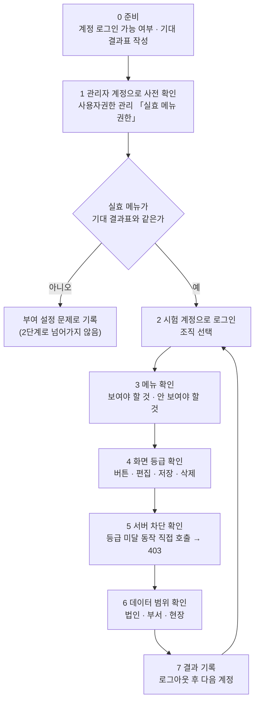

# 계정별 권한 테스트 순서

## 개요
- 목적: 시험 계정마다 부여된 권한대로 메뉴·버튼·저장·데이터 범위가 동작하는지 같은 순서로 확인하고 결과를 남기기 위함
- 대상: 공통관리·CS 화면 권한을 검토하는 개발자
- 시험 계정 근거: `products-erp-h/docs/work/common-admin/dev-guide/TEST-USERS.md`, `products-erp-h/docs/work/common-code-fn/시험계정-20261118.md`
- 권한 설정 방법: 같은 폴더 `계정-권한-흐름도.md`
- 화면별 등급 기준: `products-erp-h/docs/work/common-admin/dev-guide/auth-def/<화면ID>.md`
- 비밀번호는 이 문서와 결과 기록에 적지 않음(리드가 별도 전달)

## 전체 순서

- 한 계정의 1~7단계를 끝낸 뒤 다음 계정으로 넘어감
- 계정을 바꿀 때마다 반드시 로그아웃 후 로그인 · 권한은 로그인할 때 확정되므로 같은 브라우저 탭에서 계정만 바꾸면 이전 권한이 남을 수 있음
- 여러 계정을 동시에 열어야 하면 브라우저 시크릿 창 또는 다른 브라우저 사용

## 0단계 — 준비

### 0-1 계정 로그인 가능 여부
- TEST-USERS.md 기준으로 `erpadmin` 외 시험 계정은 P3 SQL 을 sql-h 에 적용한 뒤에만 로그인됨 → 적용 여부를 리드에게 먼저 확인
- 로그인 실패 시 비밀번호 오류인지, 계정 미생성인지 구분해 기록

### 0-2 기대 결과표 작성
시험 전에 계정마다 「무엇이 되어야 하고 무엇이 안 되어야 하는지」를 먼저 적음. 아래는 TEST-USERS.md 의 시험 목적을 옮긴 기본표이며, 화면별 등급은 권한 정의표로 채움.

| 계정 | 역할 | 로그인 조직 | 되어야 하는 것 | 안 되어야 하는 것 |
|---|---|---|---|---|
| erpadmin | SYS_ADMIN, BIZ_ADMIN | 부서 HS1910 IT팀 | 시스템·공통 메뉴 전체, 권한 화면 저장·삭제 | (없음 · 기준 계정) |
| h.dev01 | DEVELOPER | 부서 HS1910 IT팀 | 개발도구 메뉴 | 업무 화면 저장(업무 역할 미부여 시) |
| h.csadm | CS_ADMIN, CS_APRV_01, CS_COMMON | 부서 HS1930 CS팀 | 하자 업무 전체, 비용 승인 | 시스템 관리 메뉴 |
| h.cs01 | CS_MNG_01, CS_COMMON | 부서 HS1930 CS팀 | 호반건설(HS) 법인 하자 데이터 | 비용 승인 · 다른 법인 데이터 |
| h.cs02 | CS_MNG_01, CS_COMMON | 부서 HI1300 | 호반산업(HI) 법인 하자 데이터 | 호반건설(HS) 데이터 |
| h.cs03 | CS_MNG_02, CS_COMMON | 부서 HS1930 CS팀 | 하자 지원 범위 화면 | CS_MNG_01 전용 동작 |
| h.site01 | CS_SITE_01, CS_COMMON | 현장 B6H132 | 자기 현장(B6H132) 데이터 | 다른 현장 데이터 |

- 「되어야 하는 것」「안 되어야 하는 것」은 화면 단위로 구체화 필요 · 예: 「h.cs01 · 하자 접수 화면 · 등급 2 · 저장 가능 · 삭제 불가」

### 0-3 결과 기록표 준비
| 계정 | 화면(메뉴 경로·화면ID) | 확인 항목 | 기대 | 실제 | 판정 | 비고(오류 메시지·캡처) |
|---|---|---|---|---|---|---|

## 1단계 — 관리자 계정으로 사전 확인

- 관리자 계정(erpadmin)으로 로그인
- 공통 › 권한 › 권한 부여 › 사용자권한 관리 (ca-user-role) 또는 사용자권한 조회 (ca-user-role-inquiry)
- 사용자 기준으로 시험 계정 검색 → 선택
- 아래쪽 「실효 메뉴 권한」에서 메뉴·화면·등급·근거 역할 확인
- 기대 결과표와 다르면 부여 설정 문제이므로 기록 후 설정부터 바로잡음 · 이 단계에서 걸리는 문제는 화면 결함이 아님

확인할 것:

| 항목 | 확인 내용 |
|---|---|
| 부여 역할 | 기대 역할이 모두 있고, 없어야 할 역할이 없는지 |
| 부여 기간 | 시작일이 오늘 이전, 종료일이 지나지 않았는지 |
| 부여 조직 | 시험할 조직(부서·현장)에 부여되었는지 |
| 실효 메뉴 | 시험할 화면이 목록에 있고 등급이 기대와 같은지 |

## 2단계 — 시험 계정으로 로그인

- 로그아웃 → 시험 계정으로 로그인
- 부여 조직이 둘 이상이면 조직 선택 창이 뜸 → 기대 결과표의 로그인 조직 선택
- 로그인 직후 오른쪽 위 사용자 정보에서 현재 조직·법인 확인
- 같은 계정을 다른 조직으로도 시험해야 하면 로그아웃 후 다른 조직으로 다시 로그인

## 3단계 — 메뉴 확인

| 확인 | 방법 | 판정 기준 |
|---|---|---|
| 보여야 할 메뉴 | 왼쪽 메뉴 펼쳐 기대 화면 찾기 | 1단계 실효 메뉴와 같으면 정상 |
| 안 보여야 할 메뉴 | 시스템 관리·다른 업무 메뉴 펼쳐 보기 | 보이면 과다 부여 또는 기본권한(COMMON)에 업무 화면이 붙은 경우 |
| 1단계와 다름 | 실효 메뉴에는 있는데 메뉴에 없음 | 업무그룹 사용여부 N, 모듈 미포함, 다른 조직으로 로그인 여부 확인 |

## 4단계 — 화면 등급 확인

시험할 화면을 열고 권한 정의표의 등급별 「열리는 버튼·칸」과 대조함.

| 부여 등급 | 확인할 것 |
|---|---|
| 1 | 조회 결과 표시 · 저장·추가 버튼 없음 · 그리드 편집 불가 · 등급 2 이상 업무 버튼 숨김 |
| 2 | 저장·추가 동작 · 저장 후 재조회 시 값 유지 · 등급 3 전용 버튼(삭제·승인 등) 숨김 |
| 3 | 삭제·승인 등 상위 동작 수행 가능 |

- 저장·삭제 시험은 시험용 데이터로만 하고, 시험 뒤 원상 복구
- 엑셀 내려받기·올리기·인쇄 버튼은 등급과 별개인 허가 칸(allow_*)으로 정해지므로 따로 확인

## 5단계 — 서버 차단 확인

화면에서 버튼을 숨긴 것과 별개로, 서버가 등급 미달 요청을 막는지 확인함.

| 순서 | 방법 |
|---|---|
| 1 | 등급이 충분한 계정(erpadmin)으로 같은 화면을 열고, 브라우저 개발자도구(F12) 네트워크 탭에서 저장·삭제 요청의 주소와 보내는 값 확인 |
| 2 | 등급이 모자란 시험 계정으로 로그인해 같은 화면 열기 |
| 3 | 개발자도구 콘솔에서 실행 대상을 그 화면의 iframe 으로 바꾼 뒤 `app.post('/sys/<서비스>/<동작>', {...})` 로 1에서 본 요청을 직접 보냄 |
| 4 | 응답 확인 · HTTP 403 또는 `AUTH_LEVEL_DENIED` 등 권한 오류면 정상, 처리되면 결함 |

- 직접 호출로 실제 데이터가 바뀔 수 있으므로 시험용 데이터로만 시도
- 버튼이 보이는데 눌렀을 때 403 이 나는 경우도 결함으로 기록 · 화면 버튼 조건과 서버 등급의 짝이 맞지 않는 경우임

## 6단계 — 데이터 범위 확인

| 계정 | 확인 방법 | 판정 기준 |
|---|---|---|
| h.cs01 / h.cs02 | 같은 하자 목록 화면을 두 계정으로 조회 | 각자 자기 법인(HS / HI) 데이터만 보임 |
| h.site01 | 현장 조건을 비우고 조회 | B6H132 현장 데이터만 보임 |
| 공통 | 목록에서 본 행의 ID 를 바꿔 상세 조회 직접 호출(5단계 방법) | 범위 밖 ID 는 거절되거나 빈 결과 |

- 범위가 맞지 않으면 2단계 로그인 조직과 권한서비스 매핑의 데이터 범위 값부터 확인
- 부서·현장 단위 거르기(RowScope)는 설정 `SECURITY / data-scope.row-filter` 값(OFF·LOG·ENFORCE)에 따라 동작이 다르므로, 시험 전에 현재 값을 리드에게 확인

## 7단계 — 결과 기록

- 0-3 결과 기록표에 계정·화면별로 기록
- 판정 구분:

| 판정 | 뜻 |
|---|---|
| 정상 | 기대와 같음 |
| 설정 문제 | 1단계 실효 메뉴부터 기대와 다름 · 부여·매핑 수정 대상 |
| 화면 결함 | 버튼·편집 제어가 권한 정의표와 다름 |
| 서버 결함 | 등급 미달 직접 호출이 처리됨, 또는 등급 충분한데 403 |
| 범위 결함 | 다른 법인·부서·현장 데이터가 보이거나, 자기 데이터가 안 보임 |

- 결함은 화면ID·계정·재현 순서·오류 메시지·캡처를 함께 남기고, 작업대장 해당 순번의 「검토할 곳」과 대조
- 시험이 끝나면 시험 중 추가한 부여·데이터를 회수·삭제

## 공통 보안 확인(계정과 무관하게 한 번)

| 확인 | 방법 | 기대 |
|---|---|---|
| 본인 부여 차단 | 관리 등급 계정으로 사용자권한 관리에서 자기 계정에 역할 부여 | 거절(시스템관리자 제외) |
| 시스템관리자 역할 보호 | 시스템관리자가 아닌 관리 계정으로 시스템관리자 역할 수정·삭제·부여 | 거절 |
| 만료 부여 제외 | 종료일이 어제인 부여를 가진 계정으로 로그인 | 그 역할의 메뉴가 보이지 않음 |
